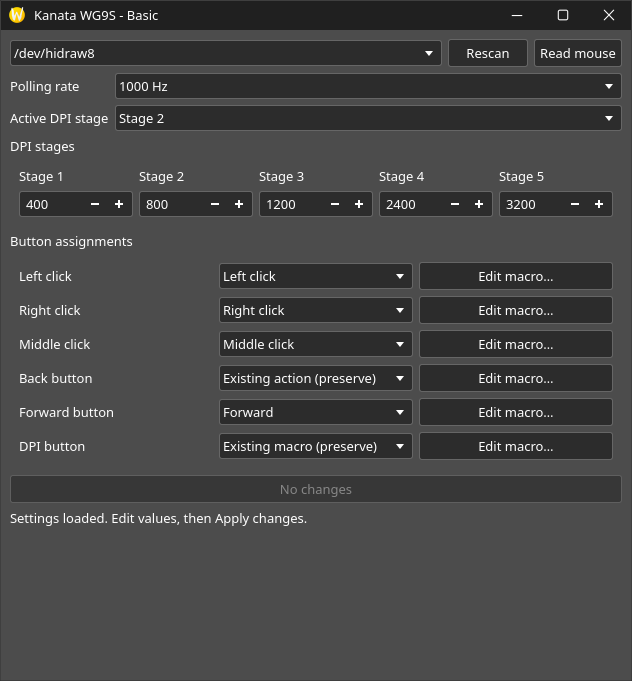

# Kanata WG9S Basic GUI

A simple Qt-based configuration tool for the Fantech Kanata S Wireless WG9S mouse.

Supports DPI settings, polling rates, button mapping, and macros.

The project includes its own backend and runs independently of Kanata Mouse Studio.

## About This Project

This project started as a desire for me to not only understand reverse engineering, How USB HID devices communicate with their software while at the same time having a driver for my mouse on Linux.

## Hardware Support

Device detection and configuration reading have been tested with a WG9S.

Configuration writing, macro playback, and battery reporting have not yet been fully verified on hardware.

Protocol details are available in `evidence/protocol/NOTES.md`.



## Installation

Requires Python 3 and PySide6.

Run directly:

```bash
python3 kanata_basic.py
```

To test the interface without connecting a mouse:

```bash
python3 kanata_basic.py --demo
```

Alternatively, install in a virtual environment:

```bash
python3 -m venv .venv
.venv/bin/python -m pip install .
.venv/bin/kanata-basic
```

## Usage

1. Connect the mouse and click **Read mouse**.
2. Adjust the settings.
3. Click **Apply changes** to save them.

Use **Edit macro…** to configure macros before applying them.

Settings are read back after writing to check the result.

## USB Permissions

Install the udev rule:

```bash
sudo install -m 0644 packaging/70-kanata.rules /etc/udev/rules.d/70-kanata.rules
sudo udevadm control --reload-rules
sudo udevadm trigger --action=change --subsystem-match=hidraw
sudo udevadm settle
```

Run the application as a regular user.

If the udev rule from Kanata Mouse Studio is already installed, no additional configuration is needed.

## License

This project's original code is licensed under the [MIT License](LICENSE).
Third-party software retains its respective licenses.
